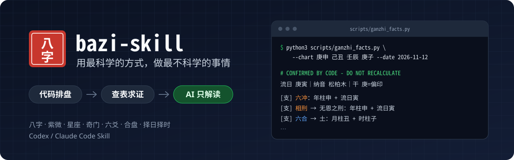
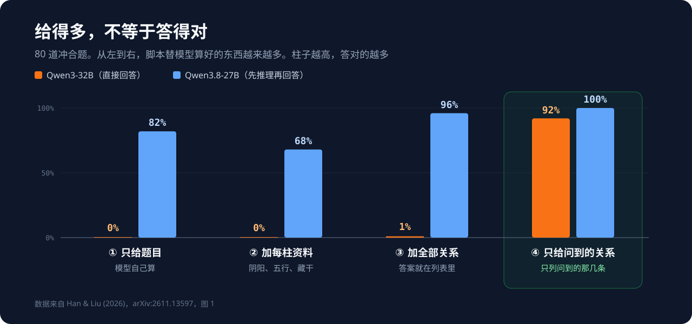
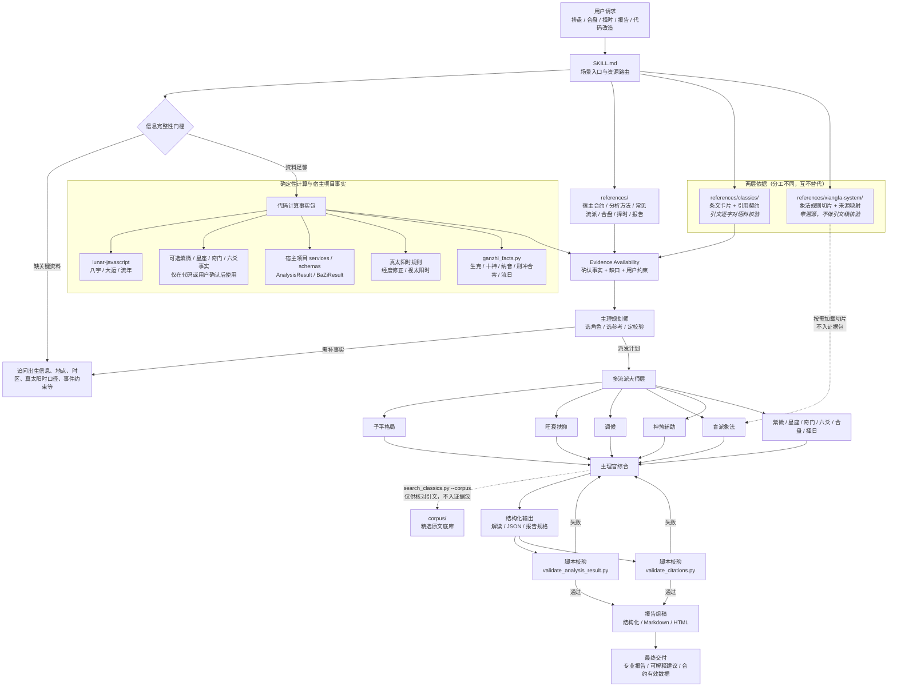

<div align="center">



<p><b>八字排盘 · 紫微斗数 · 星座合参 · 奇门六爻 · 合盘 · 择日择时</b><br>
给 Codex 和 Claude Code 用的命理 Skill。<br>代码负责算，模型负责解读。</p>

[](https://github.com/xuemian168/bazi-skill/actions/workflows/tests.yml)
[](https://github.com/xuemian168/bazi-skill/releases)
[](https://arxiv.org/abs/2611.13597)
[](LICENSE)
[](#常用命令)
[](#怎么保证算对)

[](scripts/ganzhi/table.json)
[](tests/test_ganzhi.py)
[](https://arxiv.org/abs/2611.13597)
[](scripts/validate_citations.py)
[](references/school-prompts)

<p>
<a href="https://dockon.de"><b>网页版 dockon.de</b></a> ·
<a href="#安装方式">安装</a> ·
<a href="#为什么要用代码算">为什么要用代码算</a> ·
<a href="#怎么保证算对">怎么保证算对</a> ·
<a href="#架构图">架构</a> ·
<a href="#输出案例">案例</a> ·
<a href="#配套论文与引用">论文</a>
</p>

</div>

---

## 为什么要用代码算

读一张八字盘，要先弄清很多基本事实。比如：

- 日主是什么五行；
- 某个天干对日主来说是什么十神；
- 今天是什么干支；
- 今天跟命盘的哪一柱相冲，跟哪一柱相合。

这些事实错一个，后面的解读就跟着错。

可是模型写出来的话依然很通顺。用户很难发现。

我们写了一篇论文，专门测这个问题：[arXiv:2611.13597](https://arxiv.org/abs/2611.13597)。

我们出了两组题。每道题都有标准答案，可以查表核对。

- 第一组是 682 道基础题。比如：甲和庚之间，谁克谁？
- 第二组是 160 道冲合题。给一张命盘和一个日子，问这一天跟每一柱有哪些冲、合、刑、害。

同一道题，我们用 4 种方式去问模型。

下图从左到右，脚本替模型算好的东西越来越多。

<p align="center">

</p>

从图里能看出 4 件事。

1. **只靠模型自己记，基本答不对。** 11 个开源模型直接回答：算日柱，最好的只对 4%；冲合题，最好的只对 1%。
2. **只给基本资料，没有用。** 把每一柱的阴阳、五行、藏干都告诉模型，冲合题照样答不对。
3. **把所有关系都列给它，也不行。** 答案明明就在列表里，Qwen3-32B 还是只对 1%。它会把别的柱之间的关系，错当成问的那一柱。
4. **只给问到的那几条，就答对了。** 同一个模型，答对率升到 92%。

还有两点：

- 3 个商业大模型会先推理再回答。不靠脚本时，冲合题能对 68% 到 95%，也做不到全对。
- 一些小一点的开源模型，先推理再回答时，会把我们给的正确答案改错。

所以在本项目里，下面这些都由脚本 [`scripts/ganzhi_facts.py`](scripts/ganzhi_facts.py) 来算：

- 五行生克
- 十神
- 纳音
- 刑冲合害
- 当天的干支

模型只负责解读，不自己算。

## 怎么保证算对

每一步都有办法检查。

- **四柱、大运、流年**

  由 `lunar-javascript` 或宿主项目的代码来算。模型拿到结果后，不能重算。

  见 [`SKILL.md`](SKILL.md)。

- **干支的基本资料**

  只存在 [`table.json`](scripts/ganzhi/table.json) 这一个文件里。文档里的表格，测试会逐条跟它比对。

  见 [`test_ganzhi_doc_sync.py`](tests/test_ganzhi_doc_sync.py)。

- **日柱和纳音**

  跟 `lunar-javascript` 的结果逐个对照。

  见 [`test_ganzhi.py`](tests/test_ganzhi.py)。

- **冲合规则本身**

  我们用另一个工具 clingo，把规则从头写了一遍，没有看本项目的代码。两边在所有情况下的结果都一样。

  我们还故意写错规则，做了 12 个错误版本。每一个都被查了出来。

  见论文附录 G。

- **结构化输出**

  `AnalysisResult` 这类 JSON，必须先通过 [`validate_analysis_result.py`](scripts/validate_analysis_result.py) 检查，才能交付。

- **古籍引用**

  只能按卡片编号引用。原文要跟语料逐字对照。找不到出处，就写 `no_classical_basis`。

  见 [`validate_citations.py`](scripts/validate_citations.py)。

- **证据不够时**

  写 `evidence_gap`，不自己编规则。

  见 [`school-prompts/`](references/school-prompts)。

全部测试一共 195 个，只用 Python 自带的库。

代码合进 main 之前和之后，测试都会在 Python 3.9 和 3.13 上自动跑一遍。

## 这是什么

`bazi-skill` 是一个 Skill，给 Codex 和 Claude Code 用。

它能做这些事：

- 排八字，算真太阳时；
- 生成运势 K 线 JSON；
- 合盘、合婚；
- 挑日子、挑时辰；
- 写命理报告。

它也能用紫微斗数、西洋占星、奇门遁甲和六爻的结果。

前提是：这些结果由代码算出来，或者用户给了确认过的盘或卦。

暂时不能导出 PDF。

网页版是 [dockon.de](https://dockon.de)。它用代码精确计算，再配上提示词。

bazi-skill 本身是一个 harness，也就是把各个步骤串起来的那一层。它负责：

- 算出事实；
- 整理证据；
- 安排各个流派；
- 做总体规划；
- 检查结果。

模型运行时读的是 `SKILL.md`。这份 README 是给人看的。

<sub>关键词：八字排盘、四柱、紫微斗数、星座、西洋占星、现代占星、传统占星、纳音、刑冲合害、奇门遁甲、六爻、真太阳时、合盘、合婚、择日、择时、吉日吉时、Codex Skill、Claude Code Skill、BaZi、Zi Wei Dou Shu、Qi Men Dun Jia、Liu Yao、Western astrology、zodiac signs、natal chart、synastry、Chinese astrology、true solar time。</sub>

## 安装方式

仓库地址：`https://github.com/xuemian168/bazi-skill.git`

### 安装到 Codex

Codex 会从 `${CODEX_HOME:-$HOME/.codex}/skills` 发现本地 skill：

```bash
mkdir -p "${CODEX_HOME:-$HOME/.codex}/skills"
git clone https://github.com/xuemian168/bazi-skill.git "${CODEX_HOME:-$HOME/.codex}/skills/bazi-skill"
```

安装后开启新的 Codex 会话，直接用自然语言提出八字、合盘、择日择时、K-line JSON 或报告相关的需求，就会触发这个 skill。

### 安装到 Claude Code

在宿主项目根目录运行：

```bash
mkdir -p .claude/skills
git clone https://github.com/xuemian168/bazi-skill.git .claude/skills/bazi-skill
```

安装后在 Claude Code 中使用：

```text
/bazi-skill
```

<details>
<summary><b>从本地复制、更新与验证安装</b></summary>

如果已经下载到本地，也可以直接复制：

```bash
mkdir -p "${CODEX_HOME:-$HOME/.codex}/skills"
cp -R /path/to/bazi-skill "${CODEX_HOME:-$HOME/.codex}/skills/bazi-skill"
```

更新 Codex 安装：

```bash
cd "${CODEX_HOME:-$HOME/.codex}/skills/bazi-skill"
git pull
```

Claude Code 是项目级安装，在宿主项目中更新：

```bash
cd .claude/skills/bazi-skill
git pull
```

确认入口文件存在：

```bash
test -f "${CODEX_HOME:-$HOME/.codex}/skills/bazi-skill/SKILL.md" && echo "Codex skill installed"
test -f ".claude/skills/bazi-skill/SKILL.md" && echo "Claude Code skill installed"
```

如果本机已有 Codex 的 `skill-creator` 系统脚本，可以进一步校验 skill 格式：

```bash
python3 "${CODEX_HOME:-$HOME/.codex}/skills/.system/skill-creator/scripts/quick_validate.py" "${CODEX_HOME:-$HOME/.codex}/skills/bazi-skill"
```

</details>

## 核心原则

- 代码排盘，AI 只解读：八字四柱、大运、流年、紫微盘、西洋占星星盘/星座/相位、纳音、刑冲合害关系、奇门盘、六爻卦象、合盘关系、吉时干支等事实必须由宿主项目代码或确定性脚本计算，不能由 AI 口算或重算。
- 干支事实查表：五行生克、十神、阴阳大小（小水/大火）、纳音、藏干、旺相休囚死、刑冲合害和流日干支一律由 `scripts/ganzhi_facts.py` 按 `scripts/ganzhi/table.json` 查出，模型只引用脚本输出，不凭记忆推。
- 确认盘为真：一旦用户确认或代码输出了命盘事实，后续解释和报告都必须以这些事实为准。
- 信息先补齐：出生信息、地点/时区、真太阳时口径、合盘双方资料、择时时间范围等关键输入缺失时，先追问，不直接猜。
- 多流派会诊：复杂命理任务先由“主理规划师”选择角色、参考和校验步骤，再让多个主流流派“大师”分别解读，最后由“主理官”综合输出，避免简单拼接或平均分。
- 结构先验证：`AnalysisResult`、报告 JSON 等结构化结果必须先通过脚本校验，再视为可交付。
- 引用必须可核对：典籍条文一律通过卡片 ID 引用，原文可机械比对语料原文；
  确无可引时显式写 `no_classical_basis`。这套机制不追求让预测更准（命理判断不可证伪），
  而是让输出可追溯、可反驳、边界清楚。

## 主要能力

- 八字、紫微与星座流程：八字默认围绕 `lunar-javascript` 或宿主项目已有确定性实现；紫微、西洋占星、奇门、六爻必须先确认 repo 中已有确定性实现或用户已提供确认盘/卦，不能假设存在 `ziweiService.ts`、astrology service、qimen service 或 liuyao service。
- 真太阳时处理：区分宿主项目的经度修正口径与更严格的视太阳时口径；默认可用城市级经度，专业模式建议区县/乡镇/地图点选或手动经度，并处理时辰边界风险。
- 运势 K-line JSON：生成、修复、审查符合宿主项目 `AnalysisResult` 合约的 100 年时间线数据。
- 多流派大师会诊：先由主理规划师决定是否调用子平格局、旺衰扶抑、调候、盲派象法、刑冲合害、神煞辅助、纳音、紫微、现代/传统西洋占星、奇门、六爻、择日、合盘等角色，最终由主理官综合。
- 盲派象法有 reference：象法输出必须先看 `references/xiangfa-system/source-map.md` 和 `coverage-map.md`，再用本地规则切片；没有来源或没有落成本地规则的口诀，一律 `evidence_gap`。
- 合盘与合婚：对双方命盘进行关系动力、互补点、冲突点、阶段节奏和注意事项分析。
- 吉日吉时：按事件类型、候选日期、地点时区和硬性限制，输出可解释的择日择时排序。
- 一事一问：在已有奇门盘或六爻卦象时，对投稿、签约、合作、面试等具体问题做证据化解读。
- 专业报告：从已验证 JSON 或报告规格生成结构化、Markdown 或 HTML 风格的中文报告；当前不生成 PDF。

## 架构图



## 输出案例

以下案例均使用**随机虚构样本**（非真人），仅作输出形态示意。命盘事实由 `lunar-javascript` 确定性计算，与宿主项目 `baziService.ts` 同口径；面向用户的解读统一为文化分析与反思建议，非确定性医疗/法律/金融结论。

### 案例 1：排盘 + 速读

**输入**：女命 · 1981-01-14 01:01（公历）· 重庆（东经 106.55°）

**输出（确认命盘事实）**

| 项目 | 内容 |
|---|---|
| 真太阳时（旧版经度校正） | (106.55−120)×4 = −53.8 分 → 1981-01-14 **00:07:12**（子时，距柱变边界约 53 分、非临界） |
| 农历 | 一九八〇年腊月初九 |

| 柱 | 年 | 月 | 日 | 时 |
|---|---|---|---|---|
| 干支 | 庚申 | 己丑 | **壬辰**(日主壬) | 庚子 |

大运（女命阳年逆排，起运虚岁 2）：戊子 · 丁亥 · 丙戌 · 乙酉 · **甲申(当前)** · 癸未 · 壬午 · 辛巳 · 庚辰

> **速读**：壬水生丑月（季冬），申子辰三合水局 + 重金生身 → **身旺、金寒水冷**；全局**火（财）全无、木（食伤）极弱**。用神方向取火、木暖局疏秀，忌再添金水。年柱为庚申（1980）而非 1981，因八字以立春换岁——库已正确处理。

<details>
<summary><b>案例 2：多流派大师会诊（主理官综合，节选）</b></summary>

对上盘触发「多流派大师会诊」：并行派发 **子平格局 / 旺衰扶抑 / 调候 / 盲派象法 / 神煞辅助** 五派，各派只拿同一份证据包 + 自家流派提示词，禁止重算命盘；再经 **安全编辑** 把关，最后由 **主理官** 按源层级（代码事实 > 契约 > 方法契合度 > 跨派共识 > 单派解读）综合，不机械平均。

**跨派共识（高置信）**：身旺水寒、官印相生、缺火为纲；用神 火（财）→ 木（食伤）→ 燥土，忌金（印）、水（比劫）。

**八维方向**（方向性倾向，**非 0–100 评分**，节选）

| 维度 | 方向 | 依据 |
|---|---|---|
| 事业 | 中上 | 官印相生、身旺任官，契合体制/专业/文教/规则管理路线 |
| 财富 | 中（偏稳健） | 财星不显，成就更依赖后天努力与机遇配合；比劫旺→合作资金往来宜谨慎（风险风格，非投资建议） |
| 婚姻 | 需经营 | 夫星正官清透（正向）；夫宫合入水局、缺火暖局 → 更需用心经营，为结构倾向、非注定 |

**透明披露的分歧**：甲申运甲木「无根受冻」效力、湿土制水力度为流派内可争议项；时柱信心下调归因于真太阳时精度（未用均时差），非边界临界；神煞派自陈本项目无完整神煞引擎，仅采信「子午卯酉」，其余（文昌/贵人/驿马/华盖/空亡/纳音）一律 `evidence_gap` 不评。

</details>

<details>
<summary><b>案例 3：人生 K-line `AnalysisResult` JSON（结构示意，已截断）</b></summary>

K-line 输出必须为合约有效 JSON、`timeline` 恰好 100 条、OHLC 为 0–100、含涨跌两类、且仅一条 `isPeak: true`；交付前用 `scripts/validate_analysis_result.py` 校验。

```json
{
  "bazi": { "year": {"gan":"庚","zhi":"申"}, "month": {"gan":"己","zhi":"丑"},
            "day": {"gan":"壬","zhi":"辰"}, "hour": {"gan":"庚","zhi":"子"} },
  "birthYear": 1981,
  "startAge": 2,
  "daYun": ["戊子","丁亥","丙戌","乙酉","甲申","癸未","壬午","辛巳","庚辰"],
  "mainAttribute": "水",
  "overallScore": 72,
  "generalComment": "身旺水寒、官印相生，宜专业与规则路线，逢火木暖局之运渐显实利。",
  "investment": { "content": "财弱比劫旺，宜稳健；补火之年量力小试。", "rating": 3,
                  "opportunityYear": "2026", "style": "稳健" },
  "personality": { "content": "理性、学习力强、内敛深思。", "rating": 4 },
  "career":      { "content": "体制/专业/文教/规则管理契合度高。", "rating": 4 },
  "timeline": [
    { "year": 1981, "age": 1,  "open": 50, "close": 52, "high": 55, "low": 48,
      "summary": "起运前以月令小运论。", "detailedReview": "……" },
    { "year": 2026, "age": 46, "open": 58, "close": 71, "high": 74, "low": 56,
      "summary": "丙午补火，开财暖身窗口，机会与起伏并存。",
      "detailedReview": "……", "isPeak": true }
    /* … 共 100 条：year 从 birthYear 到 birthYear+99，age 1–100 … */
  ]
}
```

</details>

<details>
<summary><b>案例 4：单维度深推（婚姻/感情经营，节选）</b></summary>

承案例 1–2 的同一随机样本，触发「聚焦某一维度深推」。主理官先用 `lunar-javascript` 确定性算出流年干支，并标注其与**夫星（女命官杀=土）、夫宫（日支辰）、桃花（时支子）**的合冲关系，再据此综合——全程为**结构倾向 / 时机参考，非"克夫/注定"断语**。

**感情结构（节选）**：夫星正官己土透月、清而显（对象偏规矩责任型）；但夫宫辰落入申子辰水局 → 关系易受外部人际/财务牵动；印重泄官 + 全局缺火 → 关系**温度与边界需经营**。

**时机线（流年事实，节选）**

| 年 | 干支 | 十神 | 关键关系 | 性质 |
|---|---|---|---|---|
| 2026 | 丙午 | 偏财 | 子午冲·桃花动 | 财暖升温但带冲动，宜稳 |
| **2029** | **己酉** | **正官(夫星)** | **辰酉合夫宫 + 桃花** | ⭐ 正缘/关系明朗信号最强年 |
| 2030 | 庚戌 | 偏印 | 辰戌冲夫宫 | 关系/家宅易变动，宜缓决重沟通 |
| 2033–2042 | 癸未运 | — | 未含夫星根+财+暖局 | 夫星转旺、暖度回升的长线利好 |

**经营要点（节选）**：① 主动补暖（表达、陪伴、向阳暖色居所）；② 立边界、财务清晰（对治夫宫入水局、比劫旺）；③ 以"明确表达期待"替代"聚焦不足"（对治夫宫伤官）；④ 顺势择时——合夫宫/暖局之年利推进，冲刑夫宫之年宜缓决。

> 时机基于流年干支（确定性计算）；无流月/流日，不定位年内具体日期。随机虚构样本、非真人，婚姻为关系模式与时机倾向、非命定。

</details>

## 常用命令

以下命令默认在 `bazi-skill` skill 目录下运行。

查某张已确认命盘在某天的干支事实（加 `--json` 输出机器可读格式；年柱、月柱、大运需由宿主项目算好再传入）：

```bash
python3 scripts/ganzhi_facts.py --chart 庚申 己丑 癸卯 壬子 --liunian 丙午 --liuyue 戊戌 --date today
```

校验 `AnalysisResult` JSON：

```bash
python3 scripts/validate_analysis_result.py result.json
```

从标准输入校验，并显式指定出生年份：

```bash
cat result.json | python3 scripts/validate_analysis_result.py --birth-year 1990 -
```

校验整个 skill 的基础格式：

```bash
python3 "${CODEX_HOME:-$HOME/.codex}/skills/.system/skill-creator/scripts/quick_validate.py" .
```

## 目录结构

- `SKILL.md`：Codex 运行时读取的主入口，定义触发条件、工作流、验证门槛和资源路由。
- `agents/openai.yaml`：界面展示用的名称、简介和默认提示词。
- `references/`：分主题参考文档，包括项目合约、分析方法、真太阳时、紫微、星座/西洋占星、常见流派、合盘、择时、报告生成、角色分工等。
- `references/xiangfa-system/`：象法体系的来源映射、覆盖率地图、宫位象、十神象、刑冲合害象、组合象、运年触发和安全改写规则。
- `references/school-prompts/`：多流派大师与主理官的专属提示词和知识切片，要求证据不足时输出 `evidence_gap`，不补空白规则。
- `references/classics/`：古籍知识层。`index.md` 三向路由、`cards/` 按命理主题分片的条文卡片、
  `corpus/` 精选原文底库。本期 `cards/` 只有带表头的空文件，`corpus/` 为空目录 ——
  条文卡片与语料底库（含 `corpus/PROVENANCE.md` 溯源清单）随语料入库分期落地，
  校验链路先行可跑。
- `scripts/validate_analysis_result.py`：校验 K-line `AnalysisResult` JSON 的确定性脚本。
- `scripts/validate_citations.py`、`scripts/search_classics.py`：引用校验与零依赖检索。
- `scripts/ganzhi_facts.py`、`scripts/ganzhi/`：干支事实层。`table.json` 是干支静态事实的唯一数据源，`references/bazi-domain-reference.md` 的表格由测试与它对齐。

## Claude Code 兼容

宿主项目内可提供 Claude Code 项目级 skill 镜像：`<repo>/.claude/skills/bazi-skill/`。

在宿主项目根目录启动 Claude Code 后，可以用 `/bazi-skill` 调用同一套八字、可选紫微事实、可选星座/西洋占星事实、可选奇门/六爻事实、合盘、择日择时、多流派大师会诊和专业报告工作流。该镜像使用项目本地 `${CLAUDE_SKILL_DIR}` 读取 `references/` 与 `scripts/`，避免依赖个人机器上的 Codex skill 安装路径。

## 使用提醒

- 面向用户的最终表达应保持“文化分析与反思建议”的定位，不做确定性医疗、法律、金融承诺。
- 报告、合盘、择日择时等输出要写清楚计算依据、适用范围、假设条件和不确定性。
- 需要改项目代码时，先读项目内相关 `CLAUDE.md` 和 touched modules；只改 skill 文档时，不应顺手改应用代码。

## 配套论文与引用

本项目的配套论文研究的是：给语言模型配一个确定性事实层时，这个事实层该算到哪一步。论文以本项目的干支事实层（`scripts/ganzhi_facts.py` 与 `scripts/ganzhi/table.json` v1）为基础构建基准，在 11 个开源模型和 3 个闭源推理模型上比较了三种做法：只给属性、给完整关系列表、只给问题相关的关系。结论是事实层必须把干支之间的关系算好交给模型，这也是本项目"干支事实查表、模型只引用脚本输出"这条原则的依据。如果你在研究中用到本项目，请引用：

> Huixue Han and Jiaying Liu. 2026. *Compute the Interactions, Not the Attributes: What a Fact Layer Must Supply in the Chinese Sexagenary System*. arXiv:2611.13597. <https://arxiv.org/abs/2611.13597>

```bibtex
@misc{han2026compute,
  title         = {Compute the Interactions, Not the Attributes: What a Fact Layer Must Supply in the Chinese Sexagenary System},
  author        = {Han, Huixue and Liu, Jiaying},
  year          = {2026},
  eprint        = {2611.13597},
  archivePrefix = {arXiv},
  primaryClass  = {cs.CL},
  url           = {https://arxiv.org/abs/2611.13597}
}
```

## 许可

本项目采用 [Apache License 2.0](LICENSE)。

授权范围有一处需要特别说明，见 [NOTICE](NOTICE)：

- **古籍原文属公有领域**，不在本许可范围内 —— 滴天髓、子平真诠、穷通宝鉴、三命通会、渊海子平等原文，本项目既不主张也不授予任何权利。入库原文的来源、版本、sha256 与公有领域依据，逐份记录在 `references/classics/corpus/PROVENANCE.md`。
- **卡片中的原创部分受本许可覆盖** —— 白话、适用前提、反例边界、层级判定，以及 `references/` 下的提示词与方法论文档、`scripts/` 与 `tests/` 下的代码。
- 现代整理本的标点、校勘、注释与白话译文属他人著作权，**未纳入本仓库**；入库的仅为公有领域原文，本仓库中的白话均为原创。
